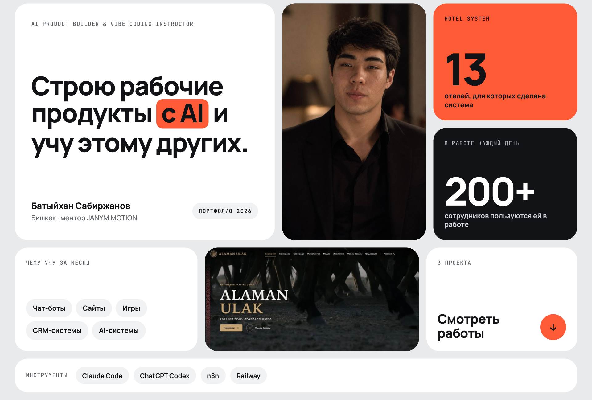
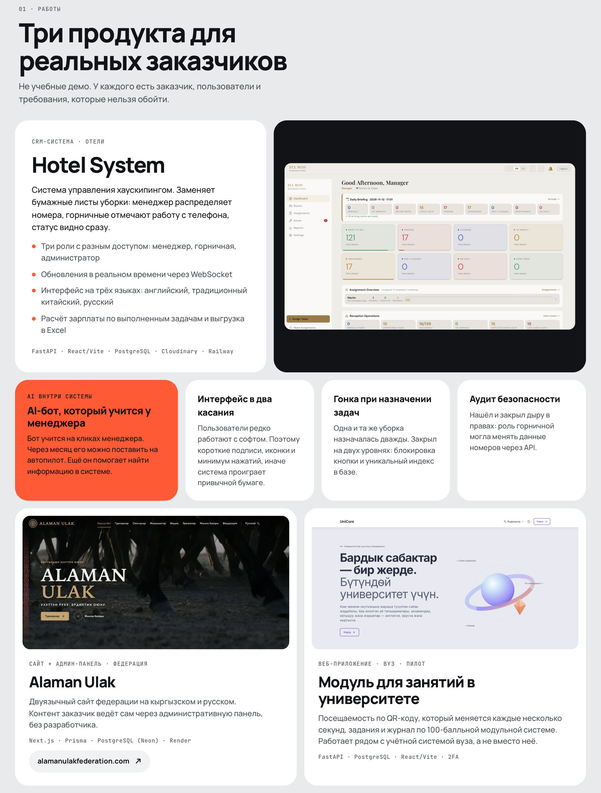
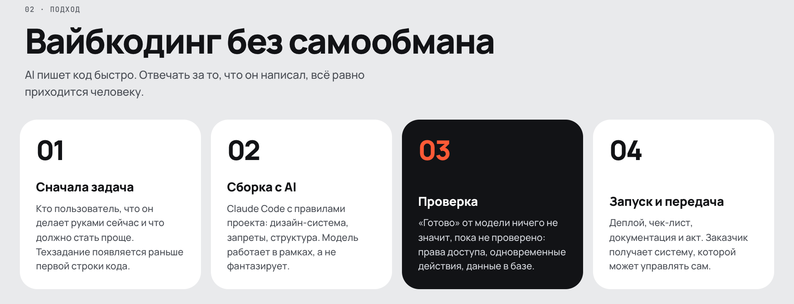
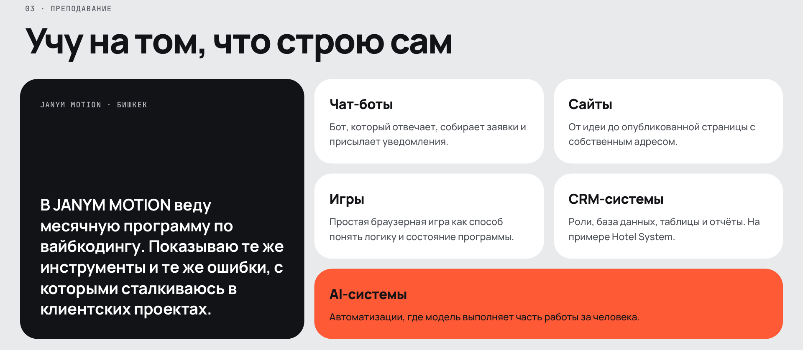

  

  

### Хотите научиться или нужен продукт?

Напишите, что хотите собрать. Отвечу, с чего начать и сколько это займёт.

  

<kbd>Русский</kbd> &nbsp;|&nbsp; <kbd>Кыргызча</kbd> &nbsp;|&nbsp; <kbd>English</kbd> &nbsp;|&nbsp; <kbd>繁體中文</kbd>

